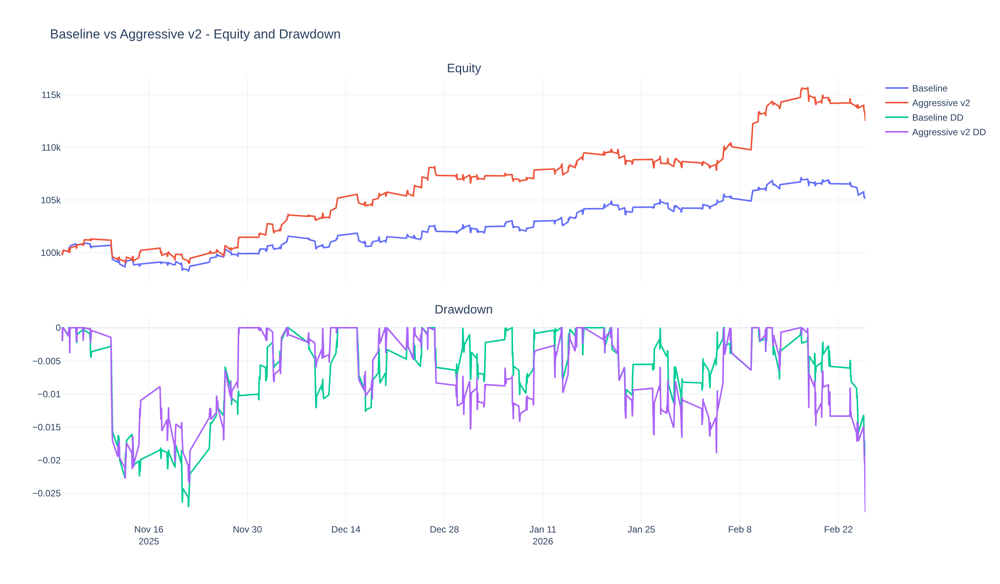
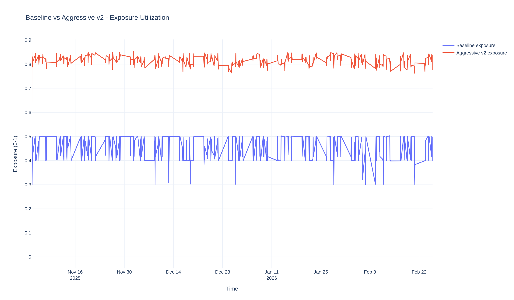
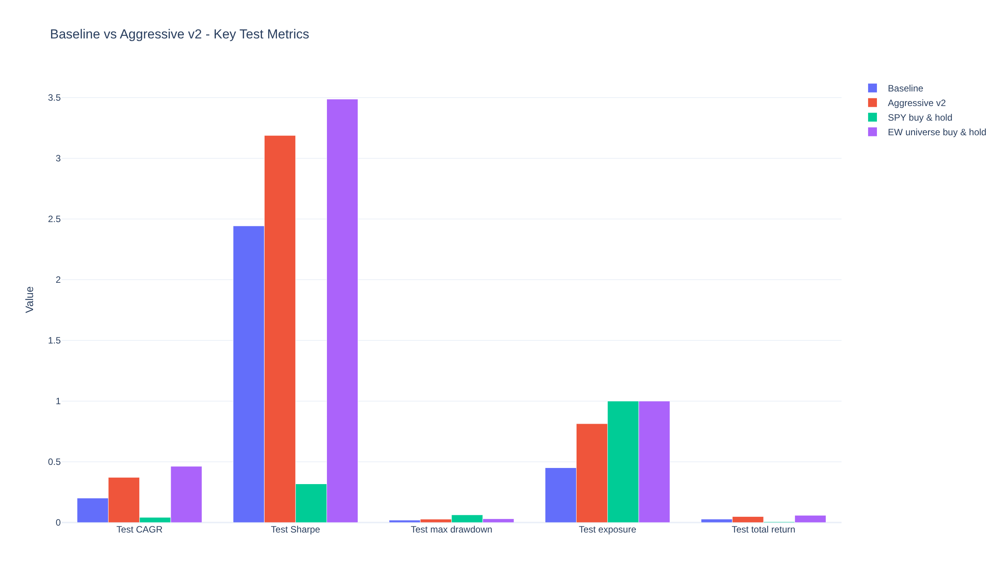
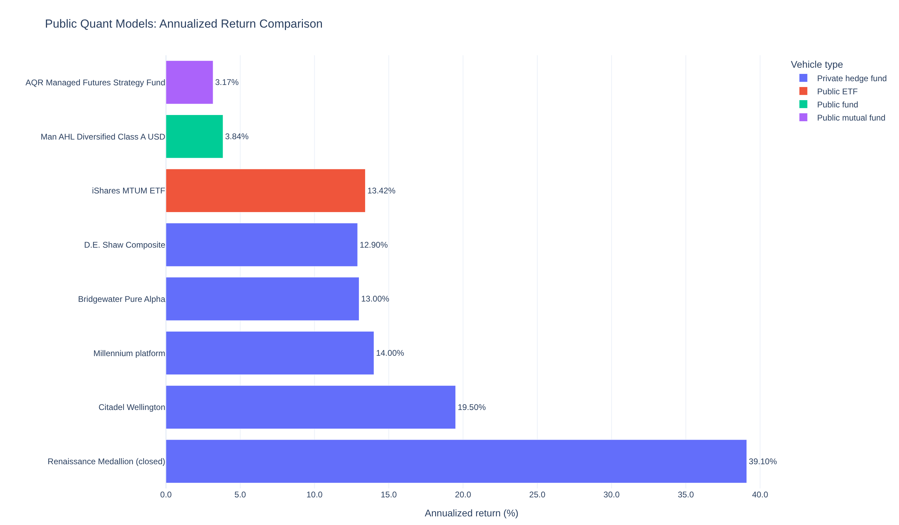
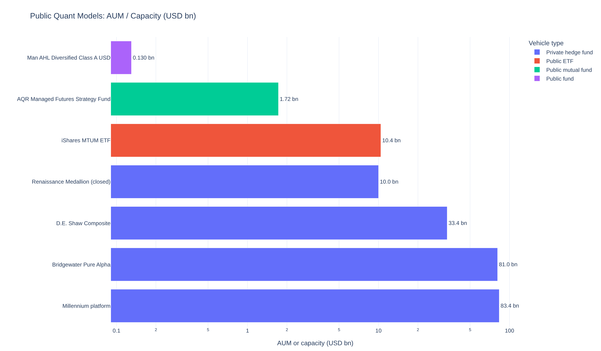
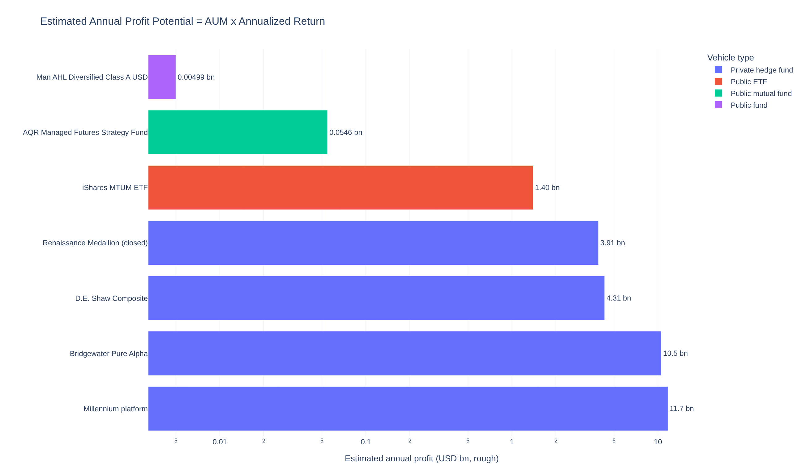
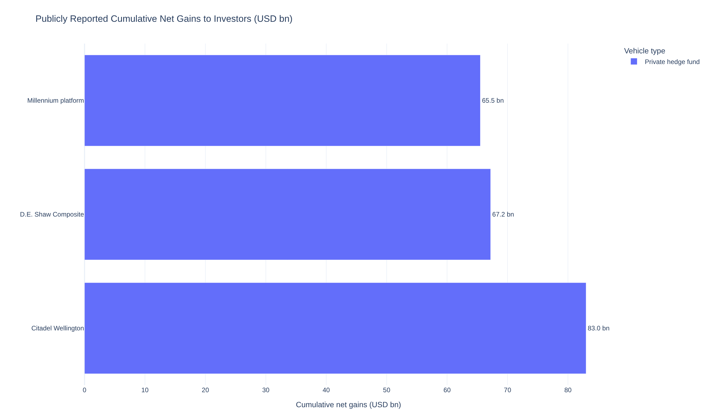
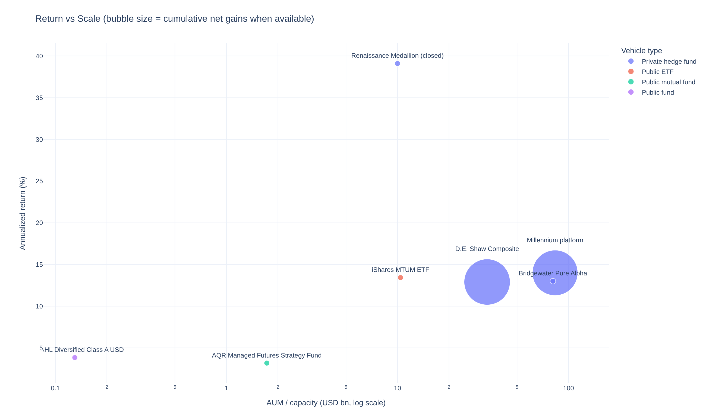

# Institutional Hourly Trading System (Production Blueprint)

This repository contains a production-grade blueprint implementation of an
**hourly long-only trading system** on **dynamic S&P 500 membership** with
strict anti-lookahead controls, cost-aware execution simulation, portfolio
optimization constraints, and analytics/dashboard outputs.

## What is included

- Point-in-time data contracts (`event_time`, `public_release_time`,
  `ingest_time`, `known_time`) and anti-lookahead enforcement.
- Feature engineering library (50+ features across price, volatility,
  cross-sectional, fundamentals, macro, sentiment, analyst, and freshness).
- Label engineering for:
  - 5-hour forward excess return vs SPY
  - downside event probability
- Model routes (all share train-fitted imputation/standardization so training
  and inference see identical preprocessing):
  - Route A: deep cross-sectional multitask model (Torch optional, deterministic fallback)
  - Route B: factor + LightGBM-style baseline (LightGBM optional, deterministic fallback)
  - Route C: adaptive ensemble that blends sub-models on a common cross-sectional rank scale
- Leakage controls: purged training (labels whose forward window crosses the
  training cutoff are dropped) and purged train/validation/test splits.
- Long-only constrained portfolio construction:
  - max 10% per stock
  - liquidity filters
  - soft sector controls
  - target volatility band (constant-correlation portfolio risk model)
  - turnover cap (including liquidation of names leaving the target)
- Event-driven hourly backtest engine:
  - signal at hour *t*
  - execution at hour *t+1 open*
  - slippage + spread + square-root impact
  - partial fill simulation
  - risk-state drawdown governance
- Metrics engine with required institutional KPIs (annualization inferred from
  the bar calendar; win rate / profit factor / holding period from fills).
- Dashboard blueprint payload builders and Streamlit starter script.
- Pytest suite (59 tests) covering anti-lookahead, label purging, accounting,
  risk regimes, metrics, broker parsing/signing, governance and live controls;
  GitHub Actions CI runs ruff + pytest on Python 3.11-3.13.
- Live production integration layer:
  - OMS/EMS adapter interfaces (paper + HTTP broker gateway)
  - signed REST adapter template (HMAC), retry policy, and idempotency keys
  - multi-broker OMS templates (Alpaca/Binance spot/IBKR gateway)
  - WebSocket callback template for order status streams
  - heartbeat + sequence checkpoint/resume for WS streams
  - gap recovery callback with REST replay template
  - exactly-once dedup storage (SQLite WAL, optional Redis)
  - real-time queue abstraction (in-memory + file-backed)
  - alert router (console/file/webhook)
  - model registry with approval workflow
  - champion/canary deployment, promotion, and rollback governance
  - fill reconciliation and broker-vs-expected break detection
  - live TCA attribution (shortfall/fees/total cost bps) from order-to-fill linkage
  - kill-switch / circuit-breaker / limit protection guard rails
  - file-backed control plane for manual kill-switch and approval-based unlock
  - RBAC policy for kill-switch / unlock approval / finalize actions

## Directory layout

```text
src/hourly_trading_system/
  data/           # PIT contracts, adapters, and store logic
  features/       # feature library
  labels/         # label engineering
  models/         # Route A (deep), Route B (factor/LGBM), Route C (ensemble)
  portfolio/      # allocation and constraints
  execution/      # transaction cost + fills
  risk/           # drawdown and risk regime controls
  backtest/       # event-driven simulation engine
  analytics/      # performance metrics
  dashboard/      # panel blueprint
  governance/     # model approval, canary, rollback controls
  live/           # queue, alerting, live contracts
  orchestration/  # research/paper/live pipeline wrapper
  io_utils.py     # atomic state writes and artifact checksums
scripts/
  run_demo_backtest.py
  run_dashboard.py
  run_live_cycle_demo.py
  run_live_monitor.py
  run_broker_ws_listener_template.py
  run_live_from_config_template.py
  run_live_hourly_loop.py
  generate_model_result_dashboard.py
  generate_public_quant_comparison_charts.py
  run_aggressive_v2_comparison.py
  run_production_preflight.py
  run_preflight.sh
  bootstrap_cloud_env.sh
deploy/
  kubernetes/     # CronJob + monitor deployment templates
  airflow/        # DAG template
  systemd/        # service/timer templates
docs/
  public_quant_model_comparison.csv
  PUBLIC_QUANT_COMPARISON_SOURCES.md
  assets/         # README comparison figures
tests/
.github/workflows/ci.yml
```

## Quickstart

### 1) Install

```bash
pip install -e ".[dev]"
```

Optional extras:

```bash
pip install -e ".[dashboard,live,ml]"
```

Cloud default environment command:

```bash
python3 -m pip install -e ".[dev,dashboard,live]"
```

### 2) Run end-to-end demo

```bash
python scripts/run_demo_backtest.py
```

This generates output files under `outputs/`:

- `equity_curve.csv`
- `fills.csv`
- `weights.csv`
- `risk_history.csv`
- `monthly_returns.csv`

### 3) Run tests and lint

```bash
pytest
ruff check .
```

### Cloud environment bootstrap script

```bash
bash scripts/bootstrap_cloud_env.sh
```
This script:
- ensures `PATH` includes `$HOME/.local/bin` (pytest discoverable),
- installs editable package with dev deps,
- validates Python/pip/pytest availability.

For cloud startup automation, see `cloud/startup.sh`.

### 4) Dashboard (optional)

```bash
streamlit run scripts/run_dashboard.py
```

### 5) Live cycle demo (registry + canary + OMS routing)

```bash
python3 scripts/run_live_cycle_demo.py
```

### 6) Real-time live monitor (queue stream, not offline CSV)

```bash
streamlit run scripts/run_live_monitor.py
```
Default queue path is `outputs/live_queue`.
The monitor includes health score, queue depths, TCA summary, and a rollback control panel.
It also includes control-plane actions:
- Force Kill-Switch
- Request Unlock
- Approve Unlock
- Finalize Unlock (requires approvals)

### Broker WebSocket listener template

```bash
python3 scripts/run_broker_ws_listener_template.py
```
Required environment variables:
- `BROKER_WS_URL`
- `BROKER_API_KEY`
- `BROKER_API_SECRET`
Optional:
- `BROKER_API_PASSPHRASE`
- `LIVE_QUEUE_PATH`
- `BROKER_WS_SEQUENCE_FIELD` (default: `sequence`)
- `BROKER_WS_SEQUENCE_STATE_PATH` (default: `outputs/ws_sequence.state`)
- `BROKER_KIND` (e.g. `binance_spot`)
- `BINANCE_REST_URL` and `BROKER_REPLAY_SYMBOL` for official replay mode
- `LIVE_DEDUP_BACKEND` (`sqlite` or `redis`)
- `LIVE_DEDUP_SQLITE_PATH` (default: `outputs/live_events.db`)
- `LIVE_DEDUP_REDIS_URL` (if using redis backend)

### Build live runner from config template

```bash
python3 scripts/run_live_from_config_template.py
```

### Scheduled hourly live loop

Single cycle:

```bash
python3 scripts/run_live_hourly_loop.py --mode synthetic --once
```

Bounded loop (for staging):

```bash
python3 scripts/run_live_hourly_loop.py --mode synthetic --max-cycles 3
```

### Deployment templates

See:

```text
deploy/README.md
```

### One-click production preflight

```bash
bash scripts/run_preflight.sh
```
This runs:
- config + environment preflight (`scripts/run_production_preflight.py`)
- smoke tests for control plane and live execution extensions.

### Generate result dashboard artifact (HTML + summary JSON)

```bash
python3 scripts/generate_model_result_dashboard.py
```
Outputs:
- `outputs/model_result_dashboard.html`
- `outputs/model_result_summary.json`
- optionally `outputs/equity_drawdown.png` (if image backend is available)

### Results on the synthetic demo dataset

All numbers below are produced by
`python3 scripts/run_aggressive_v2_comparison.py --out-dir docs/assets/v2_comparison`
(Route B model, trained through `2025-10-31` with purged labels, simulated
`2025-11-01`..`2026-02-26`, metrics on the test window `2026-01-01`..`2026-02-26`).

> **Read this first.** The demo data is generated by `scripts/run_demo_backtest.py`
> as *independent* random walks with a built-in positive drift (about 21%/yr for
> single names and about 9%/yr for SPY) and i.i.d. shocks. There is no
> cross-sectional predictability and no common market factor by construction,
> so **no model can have real alpha on it**. The relevant yardstick is the
> equal-weight buy-and-hold of the investable universe: strategy returns are
> essentially *exposure x drift*. These runs validate the plumbing (timing,
> accounting, costs, risk controls), not the strategy.

| Metric (test window) | Baseline | Aggressive v2 | EW universe buy & hold | SPY buy & hold |
|---|---:|---:|---:|---:|
| Total return | 2.81% | 4.89% | 5.92% | 0.63% |
| CAGR | 20.11% | 37.15% | 46.28% | 4.23% |
| Annualized volatility | 7.59% | 10.03% | 11.04% | 18.14% |
| Sharpe | 2.44 | 3.19 | 3.49 | 0.32 |
| Sortino | 3.58 | 4.86 | 5.32 | 0.43 |
| Max drawdown | 1.94% | 2.79% | 3.10% | 6.30% |
| Average realized exposure | 45.1% | 81.4% | 100% | 100% |
| Turnover per rebalance | 0.18 | 0.13 | n/a | n/a |
| Beta to SPY | 0.01 | 0.01 | n/a | n/a |
| Information ratio vs SPY | 0.73 | 1.34 | n/a | n/a |

**Interpretation.** Baseline (~45% invested) and Aggressive v2 (~81% invested)
earn roughly 0.45x and 0.81x of the passive equal-weight basket, which beats
both. The "improvement" of v2 is higher exposure to the synthetic drift, not
better selection. The beta to SPY is ~0 because the generator has no common
factor. To evaluate alpha, plug in real point-in-time data and compare against
an exposure-matched passive benchmark.

The full-window (`2025-11-01`..`2026-02-26`) demo with the Route C ensemble
(`python3 scripts/run_demo_backtest.py`) reports Sharpe 2.75, CAGR 21.7%,
max drawdown 2.7%, ~46% exposure, win rate 57%, profit factor 1.31 and an
information ratio of -1.32 vs SPY (SPY rallied 14% over that window).

> Earlier versions of this README reported a 1.05% test-window return with
> ~25% exposure and "Sharpe > 1 = successful". Those figures were produced by
> an engine with several accounting bugs (zero benchmark, volatility in the
> wrong units, positions not liquidated on de-risking, and more); see
> [`CHANGELOG.md`](CHANGELOG.md).

### Aggressive v2 (进攻版) profile

The allocator supports aggressive deployment controls while preserving the
long-only and single-name cap constraints:

1. non-positive-score allocation (rank-preserving score shift),
2. score concentration via `score_power`,
3. exposure floor (`min_total_exposure`, scaled by the risk regime),
4. optional top-quantile filtering (`selection_quantile`).

Profile settings used by the comparison runner:

- `max_turnover_per_rebalance = 0.80` (from 0.25),
- `max_sector_weight = 0.45` (from 0.30),
- `min_dollar_volume = 1,000,000` (from 2,000,000),
- `target_vol_lower/upper = 0.16 / 0.22`,
- allocator kwargs: `downside_penalty=0.12`, `cost_penalty=0.05`,
  `require_positive_scores=False`, `score_power=1.6`, `min_total_exposure=0.75`.

Generated artifacts (`docs/assets/v2_comparison/`): `summary.json`,
`metrics_comparison.csv`, `equity_curves.csv`, `exposure_series.csv` and the
charts below.







## Public quant model comparison (公开案例：量化模型能做到多少钱)

This section adds **publicly reported** quant-fund benchmarks for scale context.

- Raw comparison data: `docs/public_quant_model_comparison.csv`
- Source mapping and caveats: `docs/PUBLIC_QUANT_COMPARISON_SOURCES.md`
- Regenerate charts:

```bash
python3 scripts/generate_public_quant_comparison_charts.py
```

### Visual comparison (more intuitive)

**1) Annualized return (%)**



**2) AUM / strategy capacity (USD bn, log scale)**



**3) Rough annual dollar profit potential = AUM x annualized return**



**4) Publicly reported cumulative net gains to investors (USD bn)**



**5) Return vs scale scatter (bubble = cumulative gains if available)**



### Quick numeric comparison (rough, educational)

| Model / strategy | Annualized return | AUM / capacity | Rough annual scale PnL (AUM x return) | Public cumulative net gains |
|---|---:|---:|---:|---:|
| Renaissance Medallion (closed) | 39.1% | 10.0 bn | 3.91 bn/yr | n/a |
| Citadel Wellington | 19.5% | n/a | n/a | 83.0 bn |
| D.E. Shaw Composite | 12.9% | 33.4 bn | 4.31 bn/yr | 67.2 bn |
| Millennium platform | 14.0% | 83.4 bn | 11.68 bn/yr | 65.5 bn |
| Bridgewater Pure Alpha | 13.0% | 81.0 bn | 10.53 bn/yr | n/a |
| iShares MTUM ETF | 13.42% | 10.41 bn | 1.40 bn/yr | n/a |
| AQR Managed Futures Strategy Fund | 3.17% | 1.722 bn | 0.055 bn/yr | n/a |
| Man AHL Diversified Class A USD | 3.84% | 0.130 bn | 0.005 bn/yr | n/a |

### Interpretation for this repository

- The repository's own demo result is intentionally **not** in this table: a
  two-month backtest on synthetic random walks is not comparable to decades of
  audited, real-money returns (an earlier version listed a 6.30% "verified"
  figure produced by a buggy engine).
- The gap versus top institutions is **not only model alpha**, but also
  **deployable capital scale + execution infrastructure + strategy capacity**.
- A realistic roadmap is:
  1. validate alpha on real point-in-time data against an exposure-matched benchmark,
  2. improve robustness across regimes,
  3. raise capital/capacity safely while keeping drawdown and slippage stable.

> Important comparability caveat:
> these figures mix private hedge funds and public ETFs/mutual funds; time
> windows, fees, lockups, leverage, and investability are different. Treat this as **context benchmarking**, not an
> apples-to-apples ranking or investment advice.

## Production assumptions and controls

- Long-only, no leverage, cash allowed. Simulated execution processes sells
  before buys and caps purchases at available cash.
- Position cap: 10% per stock.
- Signal at `t` (bar close), execute at `t+1 open`, mark at `t+1 close`.
- Training only uses samples whose 5-bar forward label is fully observable
  before `train_end`; date-only window ends (e.g. `"2026-02-26"`) include the
  whole day.
- Cost model:
  - slippage: 1.0 bps
  - half-spread: 0.5 bps
  - impact: `eta * sqrt(participation)`
- Dynamic universe handled through point-in-time membership table. Membership
  restricts *new* allocations; positions in names that leave the index are
  still priced and liquidated (held names without a bar are marked at their
  last close, never at zero). The benchmark is measured from the full market.
- Portfolio volatility uses hourly vol (`rv_20h / sqrt(20)`) and a
  constant-correlation model (`assumed_correlation`, default 0.3).
- Drawdown governance via risk state transitions:
  - normal (100% capital) → conservative (50%, drawdown ≥ 10%) → risk_off
    (flat, drawdown ≥ 20%),
  - risk_off re-arms to conservative after a cooldown (default 35 bars) with
    the peak re-baselined, because a flat book cannot recover drawdown by itself.
- Live order safety includes:
  - max orders per cycle
  - max notional per order/cycle
  - rejection-streak circuit breaker
  - intraday loss kill-switch
  - protective limit-price conversion for market orders
  - maker-checker (four-eyes) unlock: requestors cannot approve their own unlock
  - SHA-256 verified model artifacts and atomic control-plane/registry writes
  - DST-aware exchange session scheduling (America/New_York by default)

## Changelog

See [`CHANGELOG.md`](CHANGELOG.md) for the full list of correctness fixes from
the latest review, each covered by a regression test.

## Important note

This codebase is a production **blueprint + executable framework**.
For live deployment, plug in institution-approved data vendors,
OMS/EMS integration, compliance controls, and hardened infrastructure
(secrets management, authZ, full observability, and disaster recovery).
